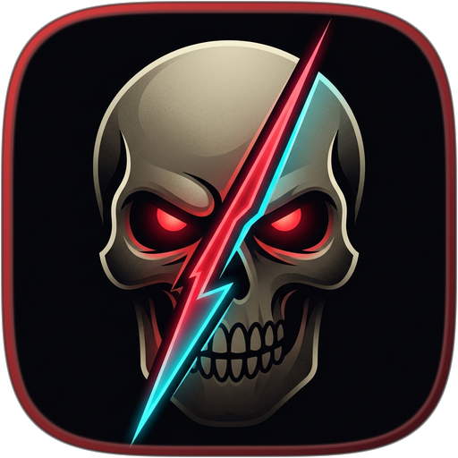
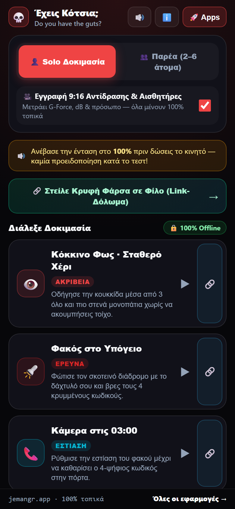
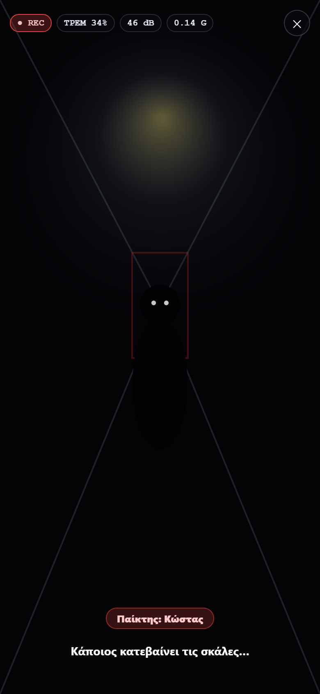

# 💀 Έχεις Κότσια; — Do You Have the Guts?

**Ελληνικό Εργαστήριο Νεύρων & Αντίδρασης — Μετράει Τίναγμα (G-Force), Ουρλιαχτό (dB), Κάμερα & Βγάζει 9:16 Video για TikTok.**

*Greek horror reaction & biometric prank lab for Android & Web PWA — 100% on-device sensors & zero servers.*

[⬇️ Λήψη APK (`test-kotsion.apk`)](https://github.com/jemangr/test-kotsion-release/releases/latest/download/test-kotsion.apk) · [🌐 Παίξε Live (iPhone & Android)](https://jemangr.app/test-kotsion/) · [📜 Changelog](./CHANGELOG.md) · [🔒 Privacy Policy](./PRIVACY_POLICY.md)

---

## 📸 Screenshots

<table>
  <tr>
    <td align="center" width="20%">
       
      <b>1. 4 Σενάρια &amp; Παρέα</b>
    </td>
    <td align="center" width="20%">
       
      <b>2. Δοκιμασία Χωρίς Spoilers</b>
    </td>
    <td align="center" width="20%">
       
      <b>3. Στιγμή Σοκ</b>
    </td>
    <td align="center" width="20%">
       
      <b>4. Κάρτα · Save &amp; Share</b>
    </td>
    <td align="center" width="20%">
       
      <b>5. Κατάταξη Παρέας</b>
    </td>
  </tr>
</table>

---

## 🔥 Τι κάνει;

* **📡 4 Πραγματικοί Αισθητήρες (100% On-Device):**
  1. **Τίναγμα Χεριού (G-Force):** Εντοπίζει το παραμικρό τράνταγμα & αναγνωρίζει *«Έπεσε το κινητό!»* (`>= 3.2 G`).
  2. **Ουρλιαχτό (dB):** Μετράει το ambient baseline και το peak κλάμα/φωνή στο σοκ.
  3. **Αντίδραση Προσώπου (Camera):** Ανιχνεύει απότομη κίνηση & κρατάει **Peak Reaction Snapshot**.
  4. **Τρέμουλο Αναμονής:** Μετράει πόσο τρέμεις *πριν* σκάσει η σκηνή.
* **🎭 6 Ενεργές Δοκιμασίες Συγκέντρωσης & 6 Αυτόνομα Zero-Spoiler Links (`eye.html`, `diff.html`, `hearing.html`, `maze.html`, `basement.html`, `camera.html`):** `Κόκκινο Φως (3-Level Maze)`, `Φακός στο Υπόγειο`, `Κάμερα 03:00` + **3 αθώες φάρσες** (*Τεστ Όρασης 20/20*, *Βρες τις 3 Διαφορές*, *Τεστ Ακοής Hz*) — κάθε κάρτα έχει δικό της `🔗` κουμπί κοινοποίησης που ανοίγει αποκλειστικά τη συγκεκριμένη δοκιμασία με αθώο link preview & μηδέν horror spoilers!
* **💀 4 Φωτορεαλιστικά Jumpscares & 4 Εναλλασσόμενες Πραγματικές Κραυγές:** 4 αληθοφανείς εικόνες τρόμου με VHS slice glitch, zoom lunge & strobe flash, συνδυασμένες με 4 δυνατές, απότομες κραυγές (`0 ms` επίθεση) που αλλάζουν σε κάθε γύρο.
* **🎴 Προεπισκόπηση Κάρτας 9:16, Save & Share (+ Split-Screen Video):** Άμεση προεπισκόπηση & ξεχωριστά κουμπιά **💾 Αποθήκευση** (Gallery / PNG) & **📤 Κοινοποίηση** για TikTok / Reels / Stories.
* **👥 Solo & Παρέα (2–6 άτομα):** Στέφει τον **👑 Πιο Ψύχραιμο** και την **🐔 Κότα της Παρέας**.
* **🔄 Έλεγχος για Νέα Έκδοση:** Αυτόματος & χειροκίνητος έλεγχος στο `test-kotsion-release` για άμεση ενημέρωση APK.

---

## 🌐 Περισσότερες Εφαρμογές από το `jemangr.app`

| App | Περιγραφή | Σύνδεσμος |
| :--- | :--- | :--- |
| ⚡ **Ποιος Πληρώνει;** | Ελληνική multi-touch ρουλέτα παρέας με plot twists | [jemangr.app/poios-plironei](https://jemangr.app/poios-plironei/) |
| 🎲 **GameNight** | 62 ελληνικά παιχνίδια παρέας offline σε ένα κινητό | [jemangr.app/gamenight](https://jemangr.app/gamenight/) |
| 👻 **Pass & Play Terror** | Ασύμμετρο party horror & μυστήριο για 1–8 άτομα | [jemangr.app/pass-n-play-terror](https://jemangr.app/pass-n-play-terror/) |
| 🤬 **Binelik AI** | Ξέσπα σε 13+ ελληνικούς AI χαρακτήρες | [jemangr.app/binelik-ai](https://jemangr.app/binelik-ai/) |
| 🐱 **Mochi Pop!** | 8×8 block puzzle & 3D virtual pet γατάκι | [jemangr.app/mochi-pop](https://jemangr.app/mochi-pop/) |
| ⏳ **Secret Sanctum: Chrono Vault** | 3D ψυχολογικό escape room τρόμου | [jemangr.app/chrono-vault](https://jemangr.app/chrono-vault/) |

---

**Copyright © 2026 Giannis Oikonomakis ([jemangr.app](https://jemangr.app/el/)). All Rights Reserved.**

