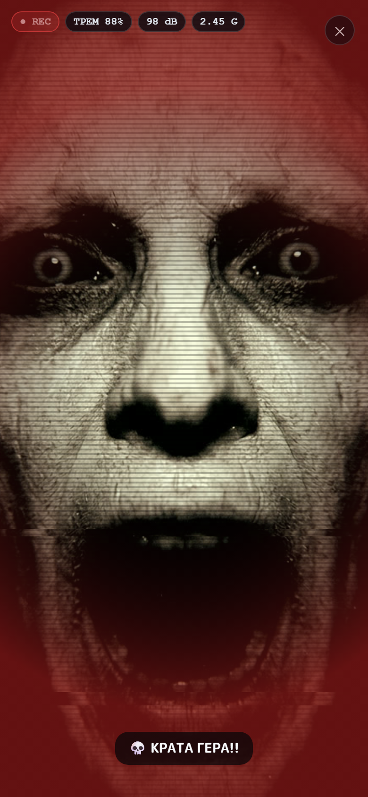
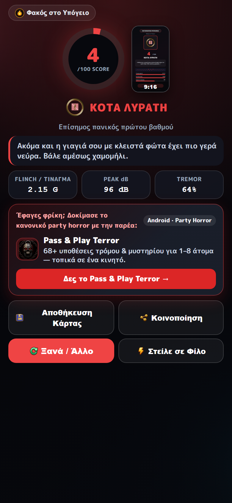
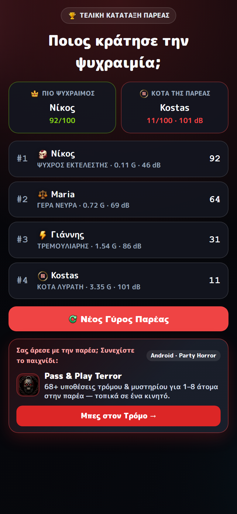

# 💀 Έχεις Κότσια; — Do You Have the Guts?

**Ελληνικό & Αγγλικό Εργαστήριο Νεύρων & Αντίδρασης (ΕΛ / EN) — 7 Δοκιμασίες, G-Force, Ουρλιαχτό (dB), Κάμερα & Κάρτα/Βίντεο 9:16.**

*Bilingual horror reaction & biometric prank lab for Android & Web PWA — 100% on-device sensors & zero servers.*

[⬇️ Λήψη APK (`test-kotsion.apk`)](https://github.com/jemangr/test-kotsion-release/releases/latest/download/test-kotsion.apk) · [🌐 Παίξε Live στο jemangr.app](https://jemangr.app/test-kotsion/) · [📜 Changelog](./CHANGELOG.md) · [🔒 Privacy Policy](./PRIVACY_POLICY.md)

---

## 📸 Screenshots

<table>
  <tr>
    <td align="center" width="20%">
       
      <b>1. 7 Δοκιμασίες &amp; Παρέα</b>
    </td>
    <td align="center" width="20%">
       
      <b>2. Δοκιμασία Εστίασης</b>
    </td>
    <td align="center" width="20%">
       
      <b>3. Στιγμή Σοκ</b>
    </td>
    <td align="center" width="20%">
       
      <b>4. Κάρτα ECG 9:16</b>
    </td>
    <td align="center" width="20%">
       
      <b>5. Κατάταξη Παρέας</b>
    </td>
  </tr>
</table>

---

## 🔥 Τι κάνει;

* **📡 4 Πραγματικοί Αισθητήρες (100% On-Device):** Τίναγμα (G-Force), Ουρλιαχτό (dB), Κίνηση Προσώπου (Camera) & Τρέμουλο Αναμονής.
* **🎭 7 Δοκιμασίες & 7 Αυτόνομα Links (`eye.html`, `diff.html`, `hearing.html`, `maze.html`, `basement.html`, `camera.html`, `scan.html`).**
* ⚠️ **Σημαντικό:** Στείλε τα links φάρσας μόνο σε όσους ξέρεις ότι το αντέχουν.
* **💀 Jumpscares & Κραυγές με WCAG 2.3.1 συμμόρφωση:** Έως 2 ήπιες αναλαμπές/δευτ., μηδενικό κόκκινο strobe, ουδέτερη οθόνη προειδοποίησης («Συνέχεια / Έξοδος»).
* **🎴 Προεπισκόπηση Κάρτας ECG 9:16, Save & Share (+ Split-Screen Video).**
* **👥 Solo & Παρέα (2–6 άτομα):** Στέφει τον Πιο Ψύχραιμο και την Κότα της Παρέας.

---

## 🌐 Περισσότερες Εφαρμογές από το `jemangr.app`

| App | Περιγραφή | Σύνδεσμος |
| :--- | :--- | :--- |
| ⚡ **Ποιος Πληρώνει;** | Ελληνική multi-touch ρουλέτα παρέας με 3D τραπέζια | [jemangr.app/poios-plironei](https://jemangr.app/poios-plironei/) |
| 🍺 **Είσαι Νηφάλιος; (18+)** | 30″ τεστ ισορροπίας, αντανακλαστικών & γλωσσοδέτη | [jemangr.app/eisai-nifalios](https://jemangr.app/eisai-nifalios/) |
| 🎲 **GameNight** | 62 ελληνικά παιχνίδια παρέας offline σε ένα κινητό | [jemangr.app/gamenight](https://jemangr.app/gamenight/) |
| 👻 **Pass & Play Terror** | Ασύμμετρο party horror & μυστήριο για 1–8 άτομα | [jemangr.app/pass-n-play-terror](https://jemangr.app/pass-n-play-terror/) |
| 🤬 **Binelik AI** | Ξέσπα σε 13+ ελληνικούς AI χαρακτήρες | [jemangr.app/binelik-ai](https://jemangr.app/binelik-ai/) |
| 🐱 **Mochi Pop!** | 8×8 block puzzle & 3D virtual pet γατάκι | [jemangr.app/mochi-pop](https://jemangr.app/mochi-pop/) |
| ⏳ **Secret Sanctum: Chrono Vault** | 3D ψυχολογικό escape room τρόμου | [jemangr.app/chrono-vault](https://jemangr.app/chrono-vault/) |

---

**Copyright © 2026 Giannis Oikonomakis ([jemangr.app](https://jemangr.app/el/)). All Rights Reserved.**

